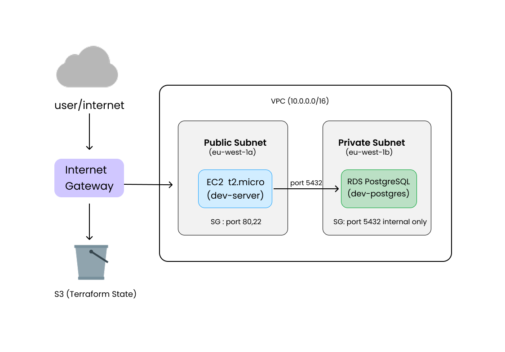

# AWS Infrastructure with Terraform

Modular Terraform for a small AWS web stack: a VPC with public and private subnets,
an EC2 web server and a private PostgreSQL RDS database, with remote state and a
GitHub Actions pipeline that checks every change.

## Architecture



| Component | Details |
|---|---|
| **VPC** | `10.0.0.0/16` with a public subnet (eu-west-1a) and two private subnets (eu-west-1b, eu-west-1c) |
| **Routing** | Public route table sends `0.0.0.0/0` to the internet gateway; private subnets have no internet route |
| **EC2** | Amazon Linux 2023 web server in the public subnet, IMDSv2 required, encrypted root volume |
| **RDS** | PostgreSQL 16 in the private subnets, encrypted, not publicly accessible |
| **State** | Remote state in S3 (versioned, encrypted) with DynamoDB locking |
| **CI** | GitHub Actions runs `fmt`, `validate` and `plan` on every push and pull request |

## Security

- **No secrets in code.** The RDS master password is generated by AWS and stored in Secrets Manager (`manage_master_user_password`).
- **Least-privilege networking.** The database only accepts connections from the web server's security group.
- **SSH is off by default.** It opens only to a single IP you pass in with `ssh_allowed_cidr`.
- **Encryption** for the RDS storage, the EC2 root volume and the state bucket.

## Structure

```
main.tf          Providers, backend and module wiring
backend.tf       S3 bucket and DynamoDB table for remote state
variables.tf     Root inputs (ssh_allowed_cidr)
outputs.tf       Server IP, DB endpoint, DB secret ARN
modules/
  vpc/           VPC, subnets, internet gateway, public route table
  ec2/           Web server and its security group
  rds/           PostgreSQL instance, subnet group and security group
```

## Usage

```bash
terraform init
terraform plan
terraform apply

# Optional: allow SSH from your current IP only
terraform apply -var="ssh_allowed_cidr=$(curl -s https://checkip.amazonaws.com)/32"
```

Get the database password:

```bash
aws secretsmanager get-secret-value \
  --secret-id "$(terraform output -raw db_master_secret_arn)" \
  --query SecretString --output text
```
